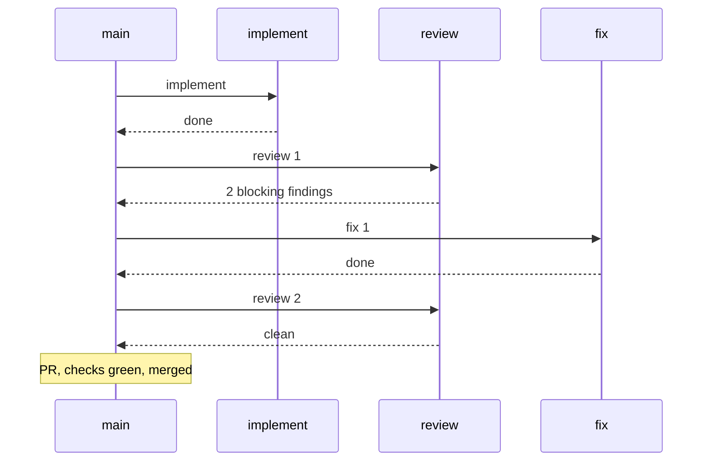

# Flow diagram

Load this for step 8 of `retro`. The diagram shows which agent was called in which order, per PBI, so a third fix round, a re-review or a pause is visible.

## Source (measured, never inferred)

1. An `agentlens` timeline of subagent calls (role, start, end), if the installed version has one (check `agentlens --help`).
2. Otherwise the `Agent`/`Task` tool calls of the session transcript: role from the call's description (`implement #<nr>`, `review`, `fix`, `release-review`), order from the timestamps of the calls.
3. Neither available: write `flow not measured` instead of a diagram. Do not reconstruct the order from the `deliver` procedure.

Results on the arrows come from `gh` and the `deliver` report: blocking findings of the review, checks green or red, merged, paused (`needs-decision`).

## Procedure

1. Group the calls per PBI, sort by timestamp.
2. One `sequenceDiagram` per PBI: participants `main` and one per role; one message per call, labelled `<role> <round>` (round number on review and fix calls) and the result in the reply or a note.
3. At most 5 PBIs: one diagram each. More: first a compact overview (`PBI -> rounds`, e.g. `#12 -> review 2, fix 1`), then diagrams only for the PBIs flagged by the metrics (more than 2 fix rounds, red checks, paused, peak cost).
4. With `--milestone`, a last block shows the `release-review` call.
5. The diagram is a separate block; it does not count towards the 40 lines of the report.

## Example

