# Theme audit: Helix themes against poimen and VitePress

Audit for #1027 (Feature #1022). The decisions drawn from it are in [ADR 0004](../adr/0004-surface-roles-dark-elevation-density-and-named-theme-presets.md).

## How this was made

- **Today's tokens:** the demo (`apps/helix-demo`, production build of this branch off `release/next`), inset layout, 1440 x 900, headless Chrome. Dark mode is the class `app-dark` on `<html>`.
- **Docs site (VitePress):** `apps/site` as built (`pnpm build:site`): VitePress 1.6.4 with the Helix tokens bound to `--vp-c-*` (`apps/site/.vitepress/theme/helix.css`). The stock VitePress values quoted as "VP" are from `vitepress/dist/client/theme-default/styles/vars.css` of the installed version.
- **poimen:** read from `/Users/jkaufmann/Source/gravionlabs/poimen` (`src/styles.css`, `src/app/app.css`; `@gravionlabs/helix-ui` 22.2.17) and screenshotted from its production browser build. poimen is a Tauri app: without its backend the browser build shows only the shell frame (ground, inset activity bar, editor panel), so the poimen column has **no cards, table, form or overlay**. Its values were read with `getComputedStyle`. poimen sets no colours of its own besides the terminal and agent-status colours; its ground, panel, border and radius are Helix tokens.
- All values below were measured (computed styles) or read from the files named; contrast ratios are WCAG 2.x computed from those hex values.

## Mockups

Light. Each row: today's tokens (demo) | poimen | docs site (VitePress).

|                     | Today (demo)                                                    | poimen                                                  | Docs site                                                    |
| ------------------- | --------------------------------------------------------------- | ------------------------------------------------------- | ------------------------------------------------------------ |
| Shell, cards, table | 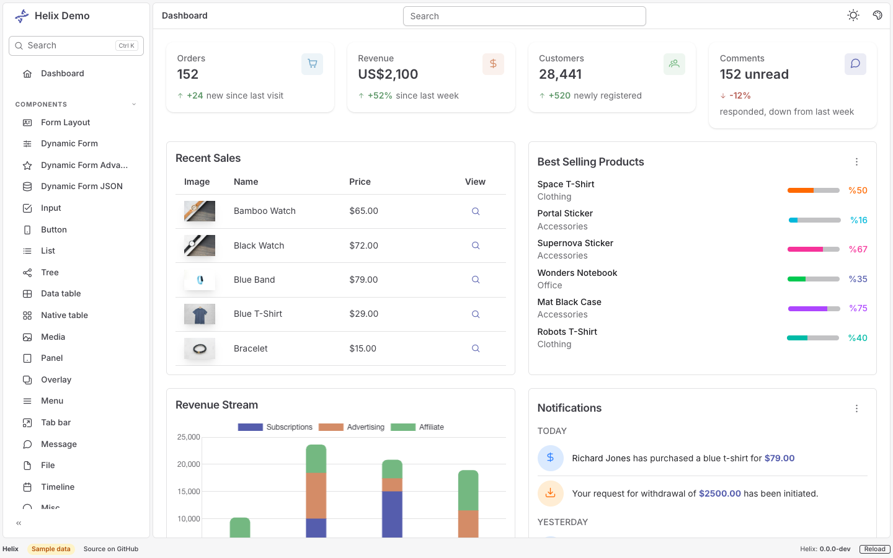 | 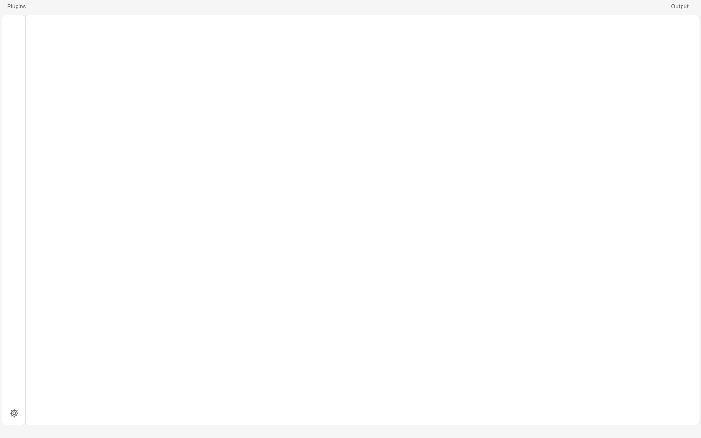 | 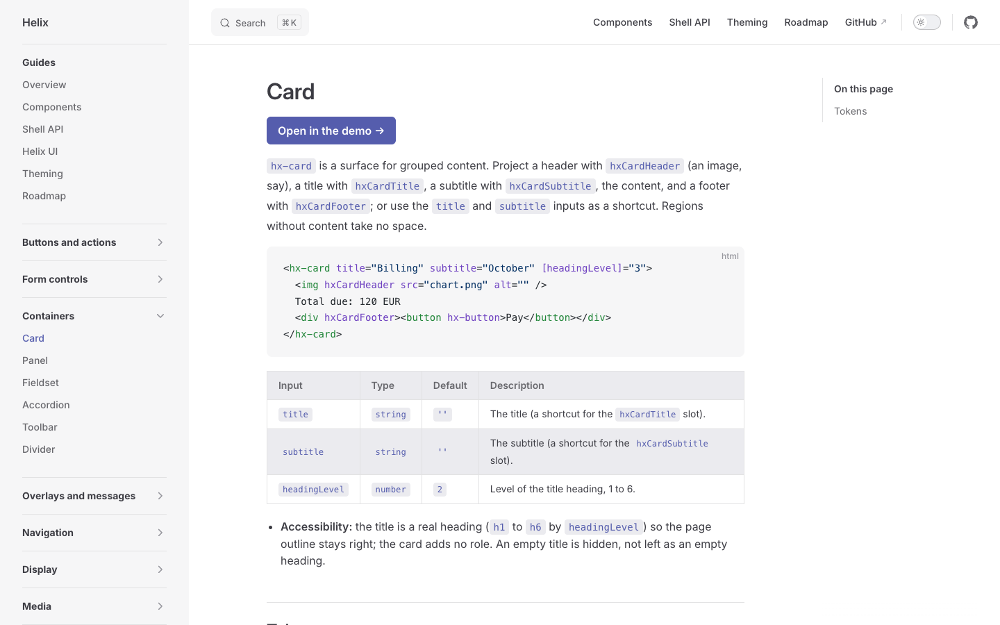   |
| Form                | 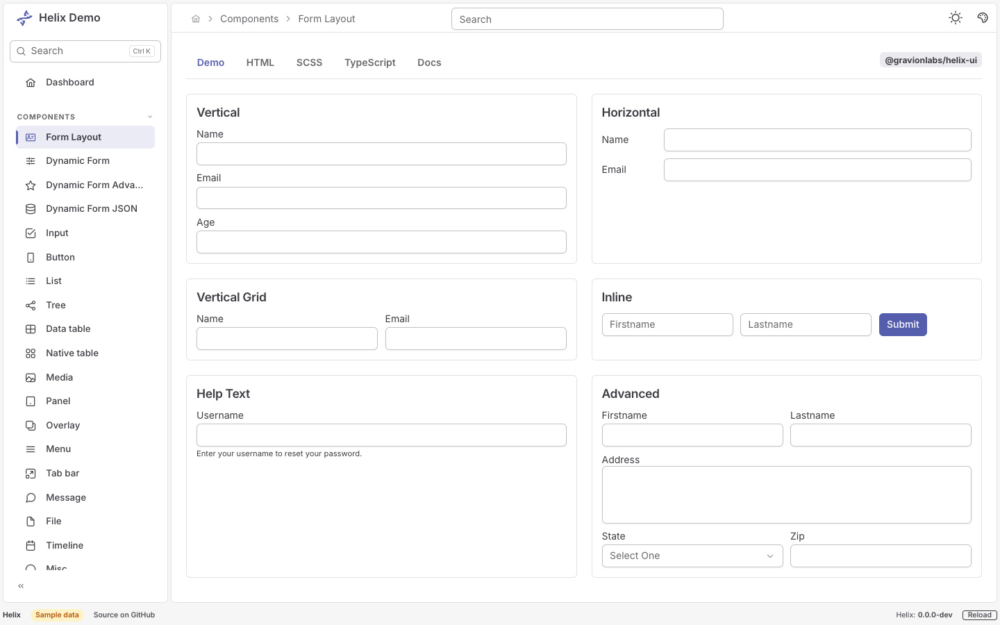      | no form reachable                                       | 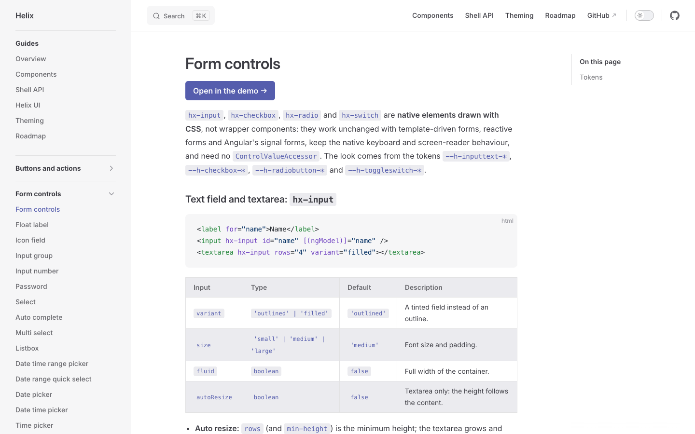   |
| Overlay             | 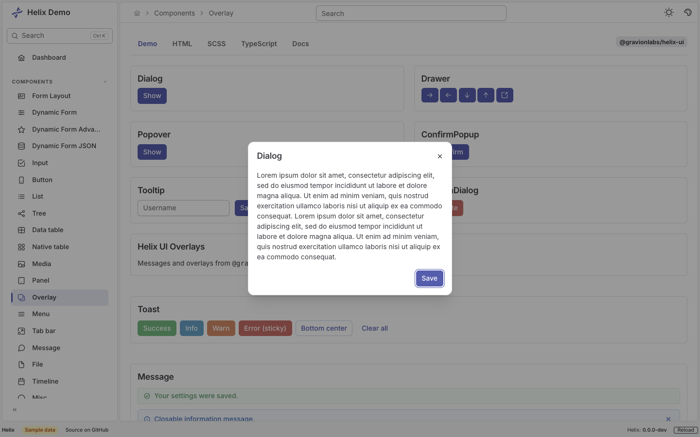    | no overlay reachable                                    | 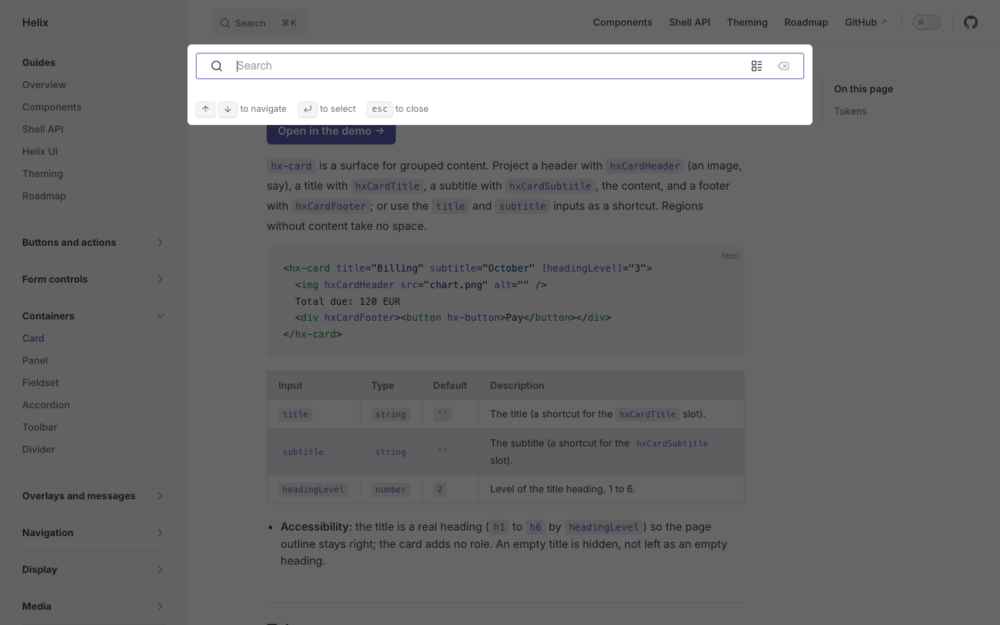 |

Dark.

|                     | Today (demo)                                                   | poimen                                                 | Docs site                                                   |
| ------------------- | -------------------------------------------------------------- | ------------------------------------------------------ | ----------------------------------------------------------- |
| Shell, cards, table | 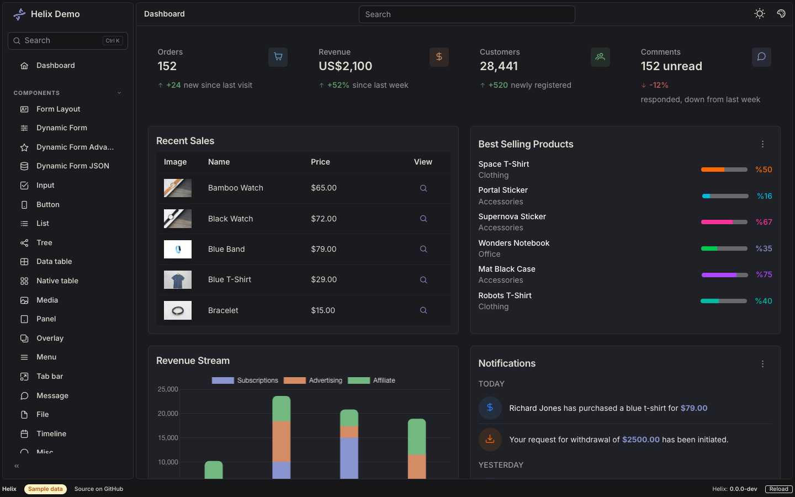 | 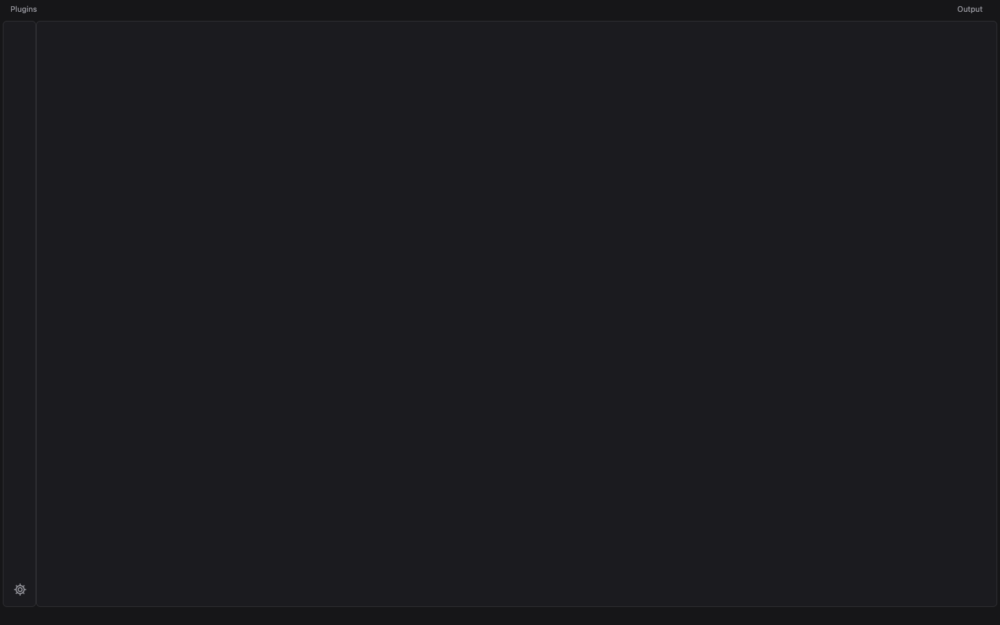 | 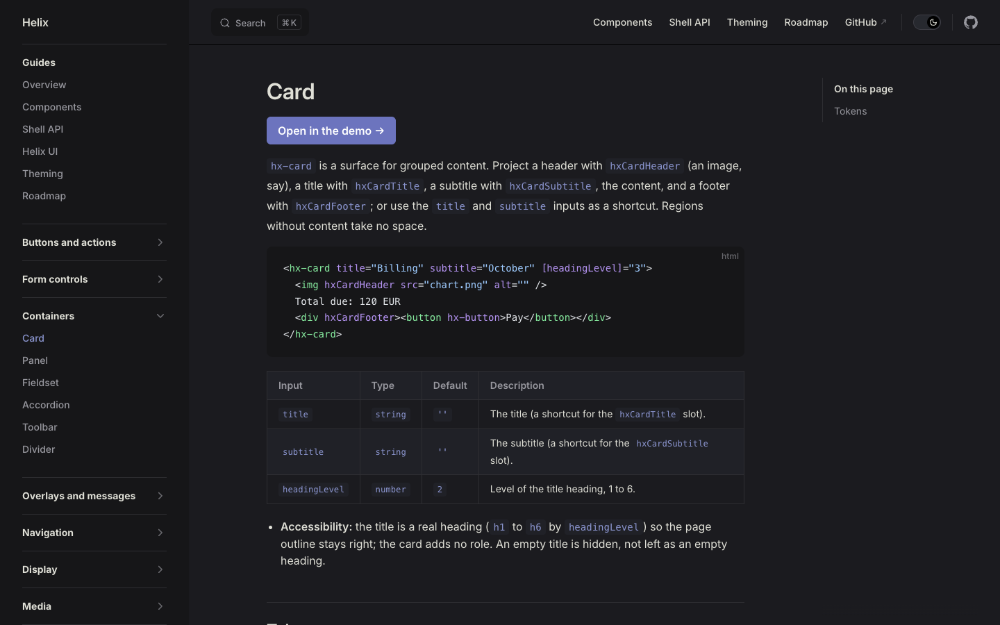   |
| Form                | 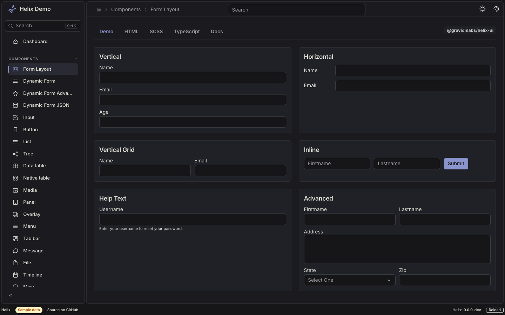      | no form reachable                                      | 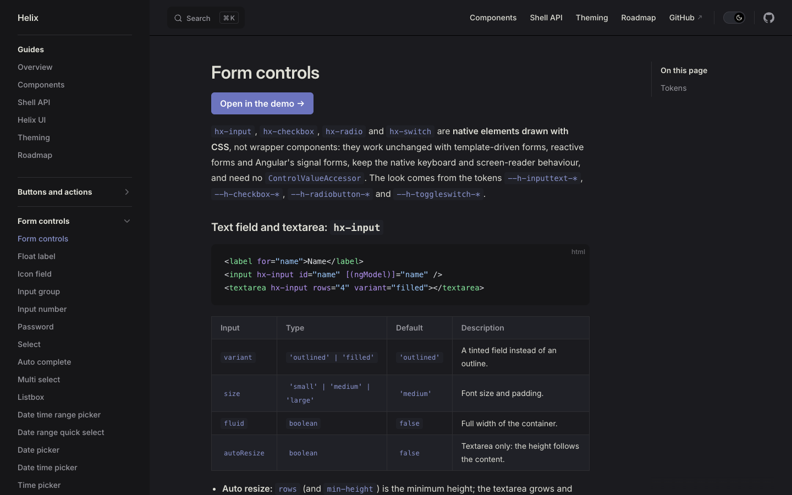   |
| Overlay             | 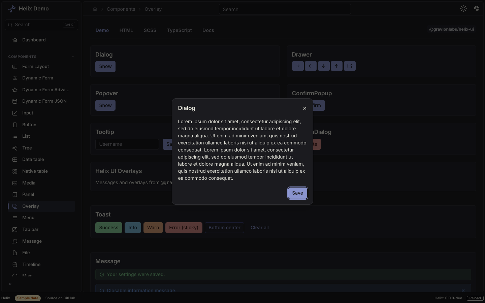    | no overlay reachable                                   | 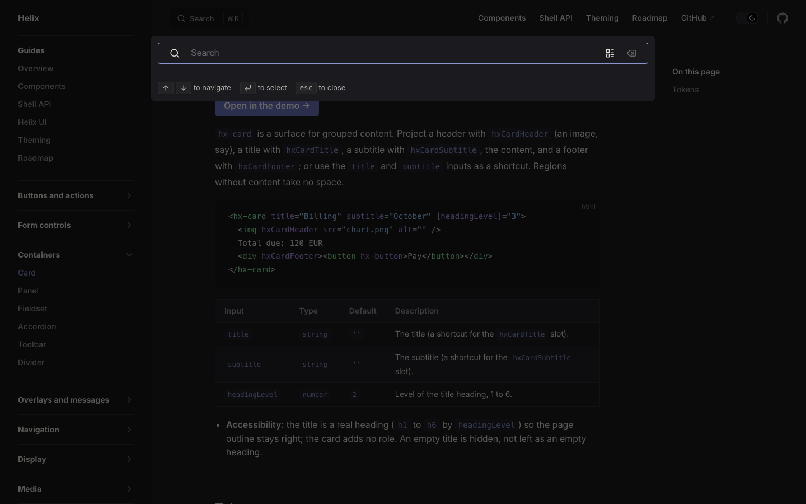 |

The docs site has no nav rail in the inset sense (a flat sidebar on `surface.50` / `surface.950`) and its "form" is the documentation of the form controls, its overlay is the search dialog; there is no live form in VitePress.

## Measured values

| Role                      | Today light                                                     | Today dark                         | poimen light / dark             | VP light / dark                                                                             |
| ------------------------- | --------------------------------------------------------------- | ---------------------------------- | ------------------------------- | ------------------------------------------------------------------------------------------- |
| Frame (ground)            | `#f6f6f7`                                                       | `#161618`                          | `#f6f6f7` / `#161618`           | `bg-alt` `#f6f6f7` / `#161618`                                                              |
| Panel                     | `#ffffff`                                                       | `#1b1b1f`                          | `#ffffff` / `#1b1b1f`           | `bg` `#ffffff` / `#1b1b1f`                                                                  |
| Panel border              | 1 px `#e2e2e3`                                                  | 1 px `#2e2e32`                     | same                            | divider `#e2e2e3` / `#2e2e32`                                                               |
| Panel radius              | 6 px                                                            | 6 px                               | 6 px                            | code blocks 8 px, inline code 4 px                                                          |
| Card (`hx-card`)          | `#ffffff`, no border, 12 px radius, shadow `0 1px 3px` 10 %     | `#1b1b1f` (= panel), same shadow   | none                            | `bg-soft` `#f6f6f7` / `#202127` for code and table head                                     |
| Table head                | `#ffffff` (= card)                                              | `#1b1b1f`                          | none                            | `bg-soft` (`surface.100` on the site) / `#202127`, 1 px divider on cells                    |
| Field border              | `#c2c2c4`                                                       | `#3c3c43`                          | none                            | `border` `#c2c2c4` / `#3c3f44`                                                              |
| Overlay (dialog, popover) | `surface.0`, mask 40 %                                          | `surface.900` (= panel), mask 60 % | none                            | search modal `#ffffff` / `#1b1b1f`, mask 60 %, `bg-elv` `#ffffff` / `#202127` for dropdowns |
| Shadows                   | `0 4px 6px -1px` 10 % (menus), `0 20px 25px -5px` 10 % (dialog) | the same, invisible on dark        | none                            | `--vp-shadow-1..5` (4 % to 16 %)                                                            |
| Text                      | `#3c3c43`, muted `#67676c`                                      | `#dfdfd6`, muted `#98989f`         | same                            | same                                                                                        |
| Primary (text, links)     | `#555dad`                                                       | `#8a94ce`                          | same token                      | brand-1 `#3451b2` / `#a8b1ff`                                                               |
| Filled button             | `#555dad`, white text                                           | `#8a94ce`, `#161618` text          | same                            | brand-3 `#5672cd` / `#3e63dd`, white text                                                   |
| Base size                 | 14 px root                                                      | 14 px                              | 13 px, buttons 18 px, gaps 4 px | 16 px, tables 14 px                                                                         |
| Control height            | 32.8 px (button, field), rail link 33.6 px                      | same                               | 18 px (toolbar button)          | n/a                                                                                         |
| Table row                 | 55 px (48 px thumbnail), cell padding 10.5 / 14 px              | same                               | n/a                             | 42 px, cell padding 8 / 16 px                                                               |

## What is off

Each item: today, then the reference value.

### Contrast

- Filled button on the site in dark mode: `primary.500` `#6c74be` with white text is **4.30:1** (below AA 4.5); the demo's own dark button (`primary.400` with `surface.950` text) is 6.2:1; VP `#3e63dd` with white is 5.21:1.
- The `*.500` severity steps used as text on white: green `#74b881` 2.36:1, orange `#d48c67` 2.71:1, sky `#67a1c6` 2.80:1, red `#c76e67` 3.59:1 (the 45 % chroma cut at Tailwind's lightness); AA text needs 4.5:1. The 600 and 700 steps are not measured here.
- Field border `#c2c2c4` on white is 1.78:1 and, in dark, `#3c3c43` on `#161618` is 1.65:1, below the 3:1 of WCAG 1.4.11 for the boundary of a control. VP uses the same light value, so this is the reference's weakness as well; decide per component.
- Fine (checked): text `#3c3c43` on white 10.9:1 (the VP value); muted text `#67676c` 5.62:1 on white, `#98989f` 5.99:1 on `#1b1b1f`; primary `#555dad` on white 5.91:1, `#8a94ce` on `#1b1b1f` 5.89:1.

### Elevation

- Dark: frame to panel is 1.05:1, panel to a `surface.800` card 1.07:1. `hx-card` is `#1b1b1f`, the colour of the panel it sits on, although `--helix-surface-card` is `surface.800`: two role families (`--helix-surface-*` for the shell, `--h-content-*` for components) disagree. Reference: VP `bg-elv` / `bg-soft` `#202127` for raised content, poimen: ground `#161618`, panel `#1b1b1f`, hairline `#2e2e32`.
- Dark: the card shadow (10 % black) is invisible. VP shadows are 4 % to 16 %; none of them is meant to carry elevation in dark either, the hairline does.
- Dialog and popover are `surface.900`, as the panel under them; only the 60 % mask separates them. Reference: VP search modal `#1b1b1f` (also the page colour) with a 60 % mask; `bg-elv` `#202127` is the raised colour.
- Light: cards are white on a white panel and are drawn by a shadow only; poimen and VP draw a 1 px `#e2e2e3` hairline and use no shadow.

### Primary

- Light `#555dad` against VP brand-1 `#3451b2`: 5.91:1 against 7.08:1 on white. Dark `#8a94ce` against `#a8b1ff`: 5.89:1 against 8.50:1.
- The demo and the site take different dark button fills (`primary.400` with dark text versus `primary.500` with white text), so the same Helix look has two filled buttons.

### Muted hues

- Every hue is Tailwind's at 55 % chroma (`palettes.ts`); the severity colours in charts and badges look washed against the VP tinted callouts and have the low contrast above. Reference: none for severities in VP (it has `tip`, `warning`, `danger` custom blocks at `--vp-c-green/yellow/red-1`).

### Density

- Demo: 14 px root, 32.8 px controls, 21 px (1.5 rem) layout gap, 24 px card gap, 55 px table rows. poimen (same tokens): 13 px base, 4 px gaps between panels, 18 px toolbar buttons, 11 px small text, 6 px panel radius. VP docs: 16 px body, 14 px tables, 42 px rows. There is no density setting; poimen reaches its density with app CSS.

### Borders

- Panels have a 1 px hairline and a 6 px radius; cards have no border and a 12 px radius; fields 6 px and `#c2c2c4`; table head has no tint in the demo, VP has a tinted head and a 1 px `#e2e2e3` divider on every cell. Reference radius: poimen 6 px, VP 8 px for blocks.

### Documentation

- `docs/THEMING.md` said the text is near-black `surface.950`; the token is `surface.600` `#3c3c43` (muted `surface.500`). Corrected in this PBI.

## Not covered

- The demo does not follow `prefers-color-scheme` in the headless run (the screenshots set `app-dark`); whether `HxTheme` should is outside this audit.
- poimen's cards, tables, forms and overlays are not in the mockups (see above); its terminal and agent-status colours are not part of the Helix tokens.
